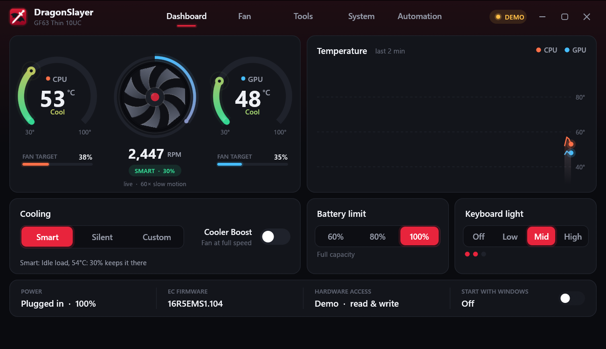

# DragonSlayer

A small, fast replacement for MSI Dragon Center on the **MSI GF63 Thin 10UC**
(EC firmware `16R5EMS1.102`). Written in Rust; one 6 MB exe.



More: [Fan, Smart mode](docs/demo-fans.png) · [Fan, curve editor](docs/demo-fans-custom.png) · [Tools](docs/demo-tools.png) ·
[System](docs/demo-system.png) · [Automation](docs/demo-automation.png)
(demo mode screenshots, made with `research/shot-demo.ps1`).

## What it does

- Live CPU / GPU temperature and the fan's real **RPM**, 2-minute
  temperature chart. The GF63 Thin has **one fan** for CPU and GPU: the
  Dashboard draws it between the two gauges, turning in step with the
  tachometer in exact 60× slow motion (the real 40–115 turns a second can't
  be shown on a screen). Each gauge shows the fan speed its curve asks for.
- Animated at a paced 60 fps while the Dashboard is visible (about 9% of
  one core), nothing when hidden in the tray or minimised
- Maximise button (or double-click the title bar): the whole layout scales
  up to fill the screen
- Fan: **Smart / Silent / Custom**, **Cooler Boost** on/off. Smart is the
  default. MSI's own curve ("Auto" in Dragon Center) is not a menu choice:
  next to Smart it only confused. It is the Factory preset inside Custom,
  and the app hands the fan back to it when it quits.
- **Custom fan curve** (Fan tab): drag 7 bars (hover shows the RPM), or pick
  Quiet / Factory / Cool / Max. Safety: 20–100%, never decreasing, and the
  two hottest steps never below factory (70%, 85%). Auto and Silent put the
  factory curve back. The presets are tuned from a measurement of this
  laptop (see "Fan measurement" in docs/how-dragon-center-works.md).
- **Smart fan mode** (Fan tab, or Cooling → Smart): the app sets the fan
  itself and keeps learning (switching it on turns Cooler Boost off).
  It learns a map of this laptop (the
  temperature each fan speed gives at each load level) and never stops
  updating it, so it follows dust, room temperature and ageing. It acts on
  load before the heat arrives, ignores short spikes, keeps going after
  load until the stored heat is gone, and remembers which programs are
  heavy so it can spin up the moment one comes to the front. The panel
  shows what it is doing and why, and the learned map. A Quieter / Balanced
  / Cooler choice shifts its target. Learned data: `%APPDATA%\DragonSlayer\
  learned.txt` (program names stay on this PC; "Forget" wipes it).
- **History log**: every 5 seconds one line (temperatures, CPU and GPU
  load, fan target, RPM, mode, battery, Smart's decision) goes to
  `%APPDATA%\DragonSlayer\history\<day>.csv`: about 1 MB a day, newest 14
  days kept, no program names, nothing leaves the PC. It is there to
  compare fan modes and tune Smart mode from real use.
- **Screen refresh** (Automation tab): Off / Battery (slow rate on battery,
  fast plugged in) / Adaptive (also fast on battery while the graphics chip
  is busy, i.e. a game). This panel offers 48 and 144 Hz only and has no
  variable refresh, so switches are rare: the wanted rate must hold 5 s and
  switches are 20 s apart.
- **Webcam** power on/off (hardware), with a check whether Windows sees a camera
- **Windows-key lock** for gaming (software hook, while the app runs)
- **Power plan** switcher (Windows plans: Balanced, Ultimate Performance, ...)
- **Scenarios** — Silent / Balanced / Performance / Extreme (Balanced and
  Performance leave the fan to Smart mode): one click sets
  power plan + fans, like Dragon Center's User Scenario page
- **Battery charge limit**: 60% / 80% / 100%
- **Keyboard light**: Off / Low / Mid / High
- Remembers your choices and **re-applies them every time it starts**
- **Start with Windows** switch (Task Scheduler, no admin prompt at login,
  starts hidden in the tray)
- **Tray icon**: temps on hover, quick menu (Cooler Boost, Silent fans,
  Open, Quit); the X button hides to the tray

Things Dragon Center can't do:

- **Heat protection** — Cooler Boost turns on automatically at 85/90/95 °C
  and off again once things have cooled down
- **When unplugged** — fans Silent and/or keyboard light off on battery,
  your own settings back when you plug in
- **System tab** — CPU usage, RAM, NVIDIA GPU load/clock/watts, and
  **battery health** (capacity vs. new, charge rate, voltage) with advice

## How to run

Installed in `C:\Program Files\DragonSlayer` (desktop shortcut and taskbar
pin point there). Install or update after a rebuild:

```
cargo build --release
powershell -ExecutionPolicy Bypass -File research\install.ps1
```

(one admin prompt for the copy; the script then tests a plain click).

**No admin prompt when you open it.** PawnIO only lets administrators talk
to the hardware, so the app needs admin rights, but the exe doesn't ask for
them (asInvoker). A click starts a normal copy that
1. brings the already-running app forward if there is one (one copy at a
   time), else
2. runs the Task Scheduler task "DragonSlayer Open" (run with highest
   privileges: admin, no prompt) and exits, else
3. asks once (UAC) — only before the task exists.

That task is only created for a copy under Program Files: only admins can
write there, so no other program can swap the exe and ride the no-prompt
launch. For the same reason the admin app finds PawnIO, `schtasks`,
`tasklist` and `nvidia-smi` by fixed paths (Program Files from HKLM,
System32 from the OS), never through PATH or environment variables.
Starting a dev build from `target\release` removes the task again (and
points Start with Windows at the dev build): reinstall to get both back.
With *Start with Windows* on, it starts at login the same way.

Command line (no GUI): `"C:\Program Files\DragonSlayer\dragonslayer-cli.exe" status | dump | watch |
fan auto|silent | curve quiet|cool|max|38,43,48,54,60,70,85 | webcam on|off |
boost on|off | charge 60 | kbd 0-3 | power [plan name]` (add
`--backend pawnio` and run from an admin terminal to use PawnIO).

Tests: `cargo test` (61 tests; Smart mode runs against a simulated laptop).
Windows-key lock check without touching the keyboard:
`cargo run --release --example winkey_check`.

## How it works

```
DragonSlayer  ──PawnIO (signed driver)──►  EC ports 0x62/0x66  ──►  Embedded Controller
```

- **Hardware access: PawnIO 2.2.0** (installed in `C:\Program Files\PawnIO`)
  with the signed `LpcACPIEC` module (`vendor/pawnio/LpcACPIEC.bin`,
  LGPL-2.1, see `vendor/pawnio/COPYING`). The app implements the ACPI EC
  read/write protocol and holds the shared `Global\Access_EC` lock.
- **Fallback:** while Dragon Center is installed, the app can also use MSI's
  own WinIO driver. That fallback disappears when Dragon Center is
  uninstalled — which is good: MSI's driver lets any program read/write all
  memory without admin.
- **Safety:** writes only happen if the EC firmware is the verified model,
  only to allow-listed registers (5 settings + the 14 fan-speed bytes; never
  the fan curve's temperature steps), only with known-valid values, and every
  write is read back.
- Full reverse-engineering notes: [docs/how-dragon-center-works.md](docs/how-dragon-center-works.md).

### Tested on this laptop (2026-11-16)

| Feature | Register | Status |
|---|---|---|
| Temps, fan % | `0x68 0x71 0x80 0x89` | reads match MSI driver |
| Fan RPM | `0xCC–0xCD` (480000 / value) | ~2,900 RPM in Auto, **~6,850 with Cooler Boost**; `0xC8` ignores Boost, `0xCA` is always 0 |
| Keyboard light | `0xF3` | **changed via PawnIO, cross-checked** |
| Fan Auto / Silent | `0xF4` | **changed via PawnIO** (Silent → Auto) |
| Cooler Boost | `0x98` bit 7 | **changed via PawnIO**, fan went to ~6,850 RPM |
| Custom fan curve | `0x72–0x78`, `0x8A–0x90` | **changed from the app**: targets went 70→82% / 54→63% within 3 s, exactly as the curve says; Auto restored factory. RPM ≈ 59.5 × percent (measured 35–100%) |
| Webcam | `0x2E` bit 1 | bit changes and reads back, **but Windows saw no camera** either way (camera may be disconnected on this unit) |
| Power plans | Windows API | switched Ultimate → Balanced → Ultimate |
| Windows-key lock | software | **works**: injected Windows key swallowed, other keys pass (`examples/winkey_check.rs`) |
| Battery limit | `0xEF` | **changed via PawnIO** (100 → 80 → 100) |
| Shift mode | `0xF2` | **blocked** — Dragon Center never uses it here |
| Settings restore | — | **works**: re-applied the saved keyboard level on start |
| Dragon Center removed | — | everything above re-checked through PawnIO afterwards |
| Start with Windows | — | **works**: started hidden in the tray after the 2026-11-17 restart |
| Smart fan mode | `0x72–0x78`, `0x8A–0x90` | built; tested only against a simulated laptop, **not yet run on this PC** |
| Screen refresh switching | Windows API | reads this screen (48 / 144 Hz); **switching not yet tried on this PC** |
| Tray, scenarios | — | built, not yet tried on this PC |

## Uninstalling Dragon Center

Done on this laptop 2026-11-16 (restore point "Before removing Dragon
Center" made first). The MSI SDK uninstaller also removed NBFoundation and
MSI's WinIO driver. Leftovers removed on 2026-11-17: MSI's `MSIO` driver
(`MsIo64.sys`, loaded at every boot, known vulnerable), `C:\ProgramData\MSI`
and the MSI registry keys except Afterburner's.

1. Open DragonSlayer. The bottom strip must say **PawnIO · read & write**.
2. Pick your fan / battery / keyboard settings (they're saved as you click),
   and turn **Start with Windows** on.
3. Windows Settings → Apps → Installed apps, uninstall:
   - **Dragon Center**
   - **MSI NBFoundation Service** (listed twice — remove both)
   - **MSI SDK**
   - Keep **MSI Afterburner** (separate, still useful). Nahimic (audio) is
     separate too — remove only if you don't use it.
4. Restart. DragonSlayer should start minimized and show
   "Restored your N saved settings", with no Dragon Center warning.

Note: the logon task points at the exe it was started from; each start
re-points it (and moves it over from the old "MSI Control" name), so moving
the exe is fine as long as you open it once from the new place.

## Layout

```
src/ec/map.rs        register map + encode/decode (unit-tested)
src/ec/pawnio.rs     PawnIO backend (ACPI EC protocol)
src/ec/winio.rs      MSI WinIO backend (fallback while Dragon Center exists)
src/controller.rs    safety layer: firmware gate, allowlist, read-back
src/settings.rs      saved settings, re-applied on start
src/automation.rs    heat protection, on-battery profile (unit-tested)
src/smart.rs         Smart fan mode: the learning brain (pure logic, simulated-laptop tests)
src/display.rs       screen refresh rates and when to switch
src/history.rs       history log (one CSV a day)
src/power.rs         Windows power plans
src/winkey.rs        Windows-key lock (keyboard hook)
src/sysinfo.rs       CPU / RAM / GPU / battery health / camera check
src/autostart.rs     Task Scheduler: Start with Windows + no-prompt "Open" task
src/elevation.rs     admin rights without a prompt, one copy at a time
src/bin/dragonslayer.rs   the app
src/main.rs          command line tool
src/icon.rs          app icon at any size, from assets/icon-256.rgba
assets/              logo: logo-source.webp (original), logo.png (cut-out
                     master), icon-256.rgba (embedded); remake both with
                     research/make-icon.ps1 -Source <new image>.
                     dragonslayer.ico = copy of the built exe icon; the desktop
                     shortcut and taskbar pin use it (a fresh path dodges
                     Windows' icon cache)
examples/winkey_check.rs   automatic Windows-key lock test
examples/icon_preview.rs   icon at 16-64 px, to check it stays readable
research/            probe/watch/test scripts; install.ps1 (install + click
                     test), measure-fan.ps1 + fan-measure-2026-11-17.csv
docs/                findings, plans, screenshot
```
