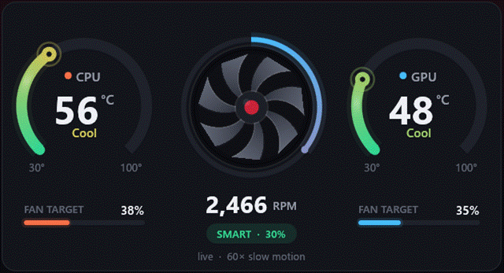
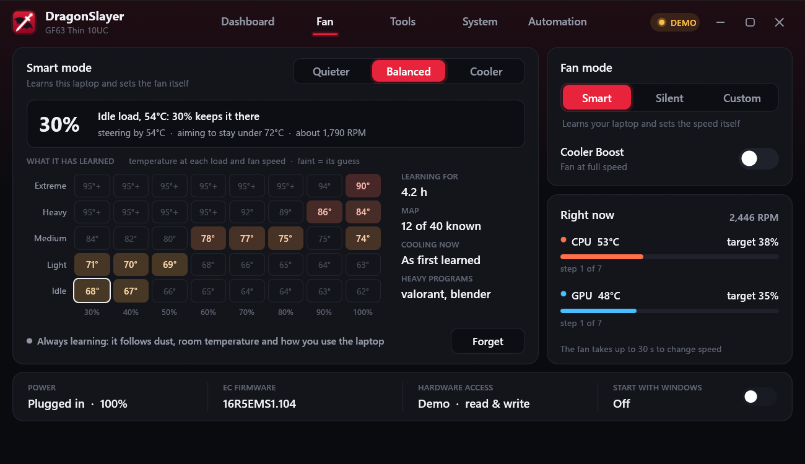
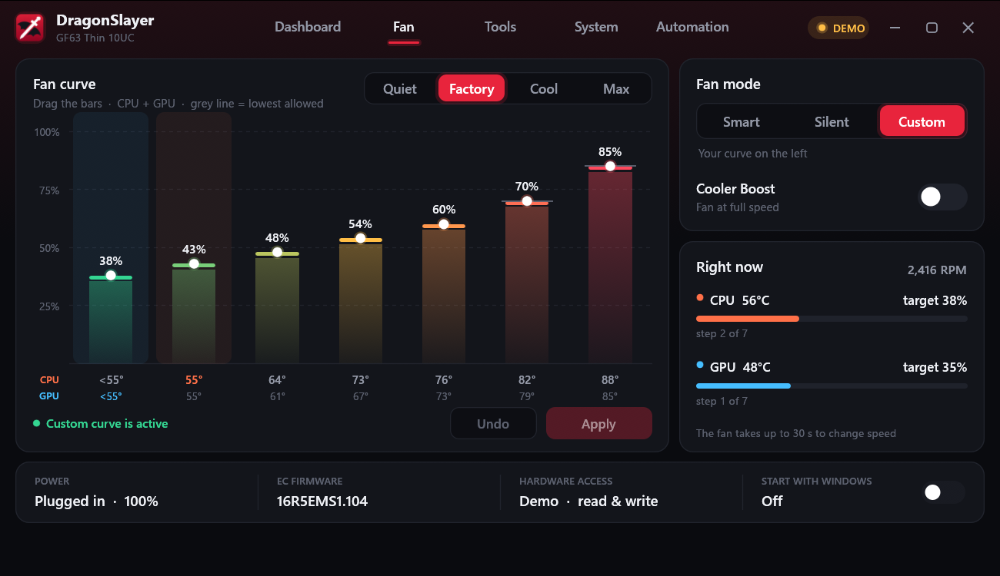
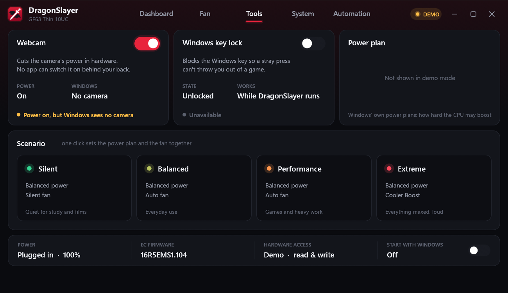
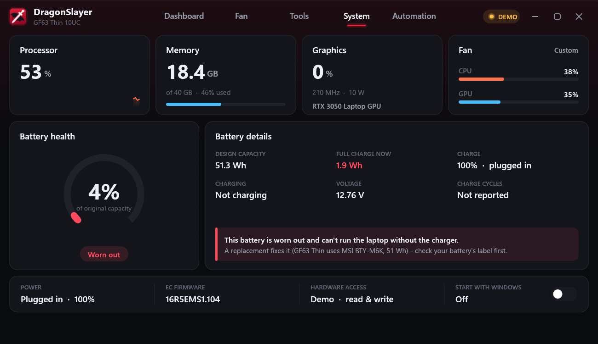
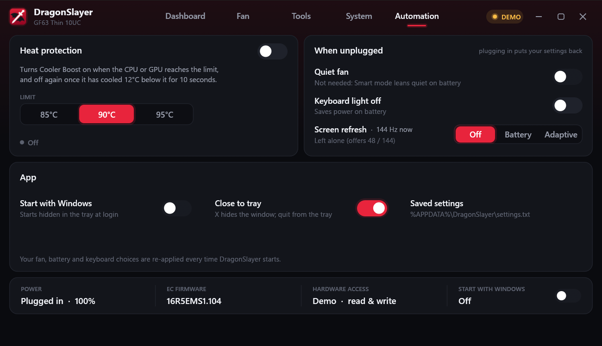

<p align="center">
  
</p>

<h1 align="center">DragonSlayer</h1>

<p align="center">
  <b>A fast, open-source replacement for MSI Dragon Center</b><br>
  Fan, battery and keyboard control for the <b>MSI GF63 Thin</b> laptop, in one 7 MB app.<br>
  No background services, no MSI drivers, and a fan mode that learns your laptop.
</p>

<p align="center">
  
</p>

> **Not affiliated with MSI.** "MSI" and "Dragon Center" are trademarks of
> Micro-Star International, named here only to say what this app replaces.
> It writes to your laptop's embedded controller: it has a firmware check and
> strict limits (see [Safety](#safety)), but use it at your own risk.

---

## Why I made this

I own an MSI GF63 Thin, and Dragon Center, the app MSI ships to control it,
was honestly the worst part of the laptop.

- **The software felt heavy.** Just to set the fan and the keyboard light
  it needed three separate installs and kept four services running all the
  time.
- **I didn't like the UI.** It just didn't look good to me.
- **It wasn't safe.** It loads two MSI kernel drivers. One of them opens
  without admin rights and lets any program on the PC read physical memory.
  The other belongs to a driver family with a published security flaw.
- **MSI's fan tuning is bad for this laptop.** When I measured it, the idle
  temperature sat right on one of the curve's steps, so the fan kept flipping
  between about 2,500 and 2,900 RPM for no reason. And because it only
  reacts to temperature, the fan always starts late: load heats the CPU by
  20 °C in seconds, while the fan needs about 25 seconds to spin up.

So I replaced it. DragonSlayer does the same jobs from one small app in the
tray, talks to the hardware through a signed, open-source driver, and looks
the way I wanted a control app to look. Its Smart fan mode learns how my
laptop actually behaves: at idle it holds about 1,800 RPM steadily instead
of hunting. On top of that it adds things Dragon Center never had: real fan
RPM, automatic heat protection, a battery-health report and a history log.

## DragonSlayer vs Dragon Center

| | Dragon Center | **DragonSlayer** |
|---|---|---|
| What gets installed | Store app + MSI SDK + MSI NBFoundation Service | **one ~7 MB exe** |
| Always-running background services | 4 (Central, Companion, Foundation, Sendevsvc) | **none**: one app, idle in the tray |
| Kernel drivers | MSI's WinIO (`KernCoreLib64.sys`): opens **without admin** and gives raw physical-memory access. MSI's MSIO (`MsIo64.sys`): a driver family with a published memory-access flaw (CVE-2019-18845) | **[PawnIO](https://github.com/namazso/PawnIO)**: signed, open source, admin-only, and only an embedded-controller module is loaded |
| Fan control | fixed curves (Auto / Silent / Basic) + a manual curve | **Smart mode that learns** + Silent + a curve editor with presets measured on the real laptop |
| What the fan reacts to | temperature only, so it is late; reacts to every spike | **load and temperature**: up before the heat arrives, ignores short spikes, knows which programs are heavy |
| Fan speed shown as | percent | **real RPM** from the tachometer, plus a live animated fan |
| Idle fan on a GF63 Thin 10UC | flips between ~2,500 and ~2,900 RPM | Smart holds **~1,800 RPM** steady (measured) |
| Overheating | Cooler Boost by hand | **automatic heat protection** (Cooler Boost on at 85 / 90 / 95 °C, off when cool) |
| Battery | charge limit | charge limit + **battery health** (capacity vs new, wear, charge rate) |
| On battery | — | optional quiet fan, keyboard light off, **48 Hz screen** |
| History | — | **14-day log** of temperatures, load and fan, to compare modes |
| Admin prompt when opening | none | none (see [How it opens without a prompt](#how-it-opens-without-a-prompt)) |
| Source code | closed | **open (MIT)** |

## Screenshots

<p align="center">
  
  <br><sub>The Dashboard live: the fan turns in step with its real RPM (in 60× slow motion) and the gauges pulse with the temperature.</sub>
</p>

| | |
|---|---|
| **Smart fan mode**: what it is doing and why, and the map it has learned<br> | **Curve editor**: drag 7 bars or pick a preset; hover shows the RPM<br> |
| **Tools**: webcam power, Windows-key lock, power plans, scenarios<br> | **System**: CPU, RAM, GPU and battery health<br> |
| **Automation**: heat protection, battery behaviour, screen refresh<br> | |

Screenshots come from demo mode (`--mock`), so the numbers are made up.
On the Dashboard the fan really spins: it is locked to the tachometer in
exact 60× slow motion, because the real fan's 40–115 turns a second can't
be shown on a screen.

## Features

**Fan**
- **Smart mode** (the default). It learns a map of your laptop, the
  temperature each fan speed gives at each load level, and keeps updating
  it, so it follows dust, room temperature and wear. It raises the fan when
  load starts, before the heat arrives, ignores spikes of a few seconds,
  keeps going after load ends until the stored heat is gone, and remembers
  which programs are heavy (by the CPU they use themselves) so it can spin
  up the moment one comes to the front. Under steady load it tries slower
  speeds on its own and keeps the quietest one that is nearly as cool.
  A *Quieter / Balanced / Cooler*
  choice shifts its aim. Everything it learns stays in
  `%APPDATA%\DragonSlayer`; *Forget* wipes it.
- **Silent** and **Custom**: a 7-point curve editor with Quiet / Factory /
  Cool / Max presets built from a measurement of the real laptop (RPM ≈
  59.5 × percent; [notes](docs/how-dragon-center-works.md#fan-measurement-and-preset-tuning-2026-11-17)).
- **Cooler Boost** on demand, and **heat protection** that switches it on
  automatically.
- Live **RPM** from the fan's tachometer. The GF63 Thin has one fan for CPU
  and GPU, and the app treats it that way.

**Battery and power**
- Charge limit 60 / 80 / 100 %, battery health with plain advice.
- Windows power plan switcher and one-click **scenarios** (Silent /
  Balanced / Performance / Extreme).
- **On battery**: optional quiet fan and keyboard light off; your settings
  come back when you plug in.
- **Screen refresh switching**: slow rate on battery, fast when plugged in
  or (Adaptive) while a game is running. Switches are rare, because each one
  blanks the screen for a moment.

**Everything else**
- Keyboard backlight (Off / Low / Mid / High), webcam power cut in hardware,
  Windows-key lock for games.
- **History log**: every 5 s, temperatures, load, fan and mode go to
  `%APPDATA%\DragonSlayer\history\<day>.csv` (14 days kept, no program
  names, nothing leaves the PC).
- Tray icon with temperatures and a quick menu; starts with Windows hidden
  in the tray; re-applies your settings on every start.
- One copy at a time: clicking the icon again brings the window forward.
- Smooth, animated UI: 60 fps while the Dashboard is visible (about 9 % of
  one CPU core), nothing while it is in the tray or minimised. Maximise
  scales the whole layout.
- Command-line tool `dragonslayer-cli` for scripting.

## Supported laptops

DragonSlayer only writes to laptops whose embedded-controller firmware it
has verified. On anything else it opens **read-only**, and its readings
may be wrong.

| Status | Models | Controller firmware |
|---|---|---|
| ✅ **Tested** | MSI GF63 Thin **10UC** | `16R5EMS1.102` |
| 🟡 **Should work, untested** (same firmware family, so the app allows it) | MSI GF63 Thin **10UD**, GF63 Thin **10SC** | `16R5EMS1.1xx` |
| ⚪ **Same register layout, not enabled yet** | GF63 8RC, GF63 Thin 9SC / 9SCSR / 10SCX(R) / 10SCS(R), GF65 Thin 9SE / 9SD / 10SCSXR / 10SD / 10SE / 10UE | `16R1`, `16R3`, `16R4`, `16W1`, `16W2` `EMS*.1xx` |

The model list comes from the [msi-ec](https://github.com/BeardOverflow/msi-ec)
project (configuration `CONF_G1_7`). Models in the last row would need their
firmware prefix added to `SUPPORTED_FW_PREFIXES` in `src/ec/map.rs` and a
careful test, since the GF65 has two fans. If you own one, an issue with
the output of `dragonslayer-cli status` is very welcome.

## Install

### Download (easiest)

1. Install **[PawnIO](https://github.com/namazso/PawnIO/releases)**, the
   signed driver DragonSlayer talks to the hardware through.
2. Download the zip from **[Releases](https://github.com/roskuttan/DragonSlayer/releases/latest)**
   and unzip it.
3. Double-click **`Install.cmd`** and click **Yes** on the admin prompt.

It copies the app to `C:\Program Files\DragonSlayer`, adds a Start menu
entry and starts it; after that it opens without any admin prompt.
`Uninstall.cmd` removes it again and gives the fan back to the laptop's own
curve. The exe isn't code-signed, so Windows SmartScreen may warn about an
unknown publisher (**More info → Run anyway**), or build it yourself:

### Build from source

You need [PawnIO](https://github.com/namazso/PawnIO) installed, Rust
(stable, MSVC toolchain) and the Windows SDK (for `rc.exe`).

```powershell
git clone https://github.com/roskuttan/DragonSlayer
cd DragonSlayer
cargo build --release
powershell -ExecutionPolicy Bypass -File research\install.ps1
```

`install.ps1` asks for admin once, copies the app to
`C:\Program Files\DragonSlayer`, starts it, and checks that a plain click
opens it without a prompt. It never creates a desktop shortcut; pin the app
from the Start menu or the tray if you want one. Try it without hardware
first: `target\release\dragonslayer.exe --mock`.

### Switching from Dragon Center

1. Open DragonSlayer. The bottom strip must say **PawnIO · read & write**.
2. Pick your settings and turn **Start with Windows** on.
3. Uninstall **Dragon Center**, **MSI NBFoundation Service** (listed twice)
   and **MSI SDK** in Windows Settings → Apps. MSI Afterburner and Nahimic
   are separate apps; keep them if you use them.
4. Restart. DragonSlayer starts in the tray and restores your settings.

MSI's uninstallers can leave the `MSIO` driver behind; check
`sc query MSIO` and remove it if you don't need it.

## How it works

```
DragonSlayer ── PawnIO (signed driver, LpcACPIEC module) ── ports 0x62/0x66 ── embedded controller
```

The laptop's fan, keyboard light and charging are run by a small chip on
the motherboard, the **embedded controller (EC)**, with its own firmware.
Its settings are single bytes. DragonSlayer reads and writes those bytes
through PawnIO using the standard ACPI EC protocol, and shares the
`Global\Access_EC` lock with other tools. The register map was worked out
from Dragon Center's own files and by watching what it changes:
[docs/how-dragon-center-works.md](docs/how-dragon-center-works.md).

### Safety

- **Firmware gate**: no writes unless the EC firmware is a verified one.
- **Allowlist**: only 5 settings and the 14 fan-speed bytes can be written,
  never the curve's temperature steps, and only with known-valid values.
  Every write is read back.
- **Fan floor**: no curve, including Smart mode's, can go below MSI's own
  speeds at the two hottest steps (70 % at 82 °C, 85 % at 88 °C), so a
  frozen app can never leave the fan slow on a hot laptop.
- **Smart mode limits**: at least 90 % fan from 88 °C, 100 % if the CPU
  stays at 92 °C. When the app quits, it hands the fan back to MSI's curve.

### How it opens without a prompt

PawnIO only lets administrators in, so the app needs admin rights, but the
exe never asks for them. A click starts a normal copy that either wakes the
copy already running, or runs a Task Scheduler task with highest
privileges and exits. That task only exists for a copy under
`C:\Program Files`, which ordinary programs can't overwrite, so it can't be
used to sneak around UAC. For the same reason the app finds PawnIO and every
helper program by fixed system paths, never through `PATH` or environment
variables.

## Tested on a real GF63 Thin 10UC

| What | Result |
|---|---|
| Temperatures, fan %, fan RPM | match MSI's own driver; RPM 1,790 at 30 % … 6,860 with Cooler Boost |
| Fan modes, custom curve, Cooler Boost, battery limit, keyboard light | changed and read back through PawnIO |
| Smart mode | running daily since 2026-11-17; tuned from its history log |
| Start with Windows, no-prompt launch, one copy at a time | verified |
| Windows-key lock | verified with an automatic test (`examples/winkey_check.rs`) |
| Webcam switch | the bit changes, but this unit's camera doesn't appear in Windows either way |
| Screen refresh switching | reads the screen's rates (48 / 144 Hz); switching itself not yet confirmed |
| Stress test (`research/stress-smart.ps1`) | Smart went to full speed within 4 s of load starting; sustained full load held the CPU at 70–72 °C; two weaknesses found and fixed ([details](docs/how-dragon-center-works.md#stress-test-smart-mode-2026-11-17)) |

`cargo test` runs 64 tests, including Smart mode against a simulated laptop
built from the real measurements.

## Project layout

```
src/bin/dragonslayer.rs   the app (window, tray, worker)
src/main.rs               dragonslayer-cli
src/smart.rs              Smart fan mode: the learning part (pure logic, simulated-laptop tests)
src/controller.rs         safety layer: firmware gate, allowlist, read-back
src/ec/                   register map, PawnIO backend (ACPI EC protocol)
src/settings.rs           saved settings
src/automation.rs         heat protection, on-battery profile
src/history.rs            history log
src/display.rs            screen refresh rates
src/power.rs, sysinfo.rs  power plans, CPU / GPU / battery readings
src/autostart.rs, elevation.rs   Task Scheduler tasks, admin rights without a prompt
docs/                     reverse-engineering notes, screenshots
release/                  installer and uninstaller that ship in the download zip
research/                 install, release build, measurement, stress-test, screenshot and GIF scripts, raw data
vendor/pawnio/            PawnIO's signed LpcACPIEC module (LGPL-2.1)
```

## Credits

- [PawnIO](https://github.com/namazso/PawnIO) by namazso: the signed
  driver and the `LpcACPIEC` module (LGPL-2.1, included in `vendor/pawnio`).
- [msi-ec](https://github.com/BeardOverflow/msi-ec): the Linux driver whose
  register map for this family was the starting point.
- Built with [egui](https://github.com/emilk/egui) and
  [tray-icon](https://github.com/tauri-apps/tray-icon).

## License

MIT; see [LICENSE](LICENSE). The bundled PawnIO module keeps its own
LGPL-2.1 license.
